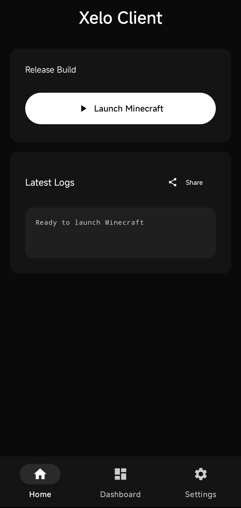
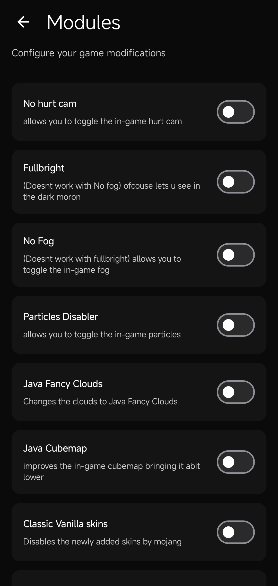

  

**Henshin Client** is an advanced minecraft bedrock client for __android__ designed for pvpers, survival players, builders etc. Henshin has alot of features and a crazy fps boost

> **We are looking for contributors/maintainers to help keep the project alive and speed up the development. You can help by fixing bugs, implementing & improving features, etc.**

## New in this version
  - [x] New launcher UI: only 3 pages - **Account**, **Home**, **Settings**
  - [x] Module system with typed values (Bool, Int, Float, Enum, Text, Color) saved per module
  - [x] Modules: **Killaura**, **Aura**, **Hitbox**, **Surround** (Combat), **Fly**, **Jetpack**, **Velocity**, **Spider** (Movement), **ItemEsp** (Render), **AutoEat** (Player), **Desync** (Misc)
  - [x] One in-game ClickGUI (the tabbed Panel); the old Toolbox GUI is no longer reachable
  - [x] Floating shortcut buttons: place them anywhere, tap to toggle a module
  - [x] Chat commands (never sent to the server): `.bind Killaura Z`, `.unbind`, `.binds`, `.toggle`, `.set <module> <value> <x>`, `.shortcut add|remove|edit|clear`, `.gui`, `.help`

> Killaura falls back to tapping the crosshair and AutoEat to a timer when the native game bridge (`libhenshin_core.so`) is not packaged.
> Spider, ItemEsp, Desync, Aura, Hitbox, Velocity, Surround, Fly and Jetpack need that bridge (game memory access) to do anything.
> Killaura's Mode / Targets / Priority / Range are only applied when the bridge is present.
>
> Without the bridge: **Killaura / Aura** tap the crosshair on their interval, **Fly** double-taps Space (the game's own creative flight), **Jetpack** holds W, and **Hitbox / Velocity / Surround** tell you they need game access and switch themselves off.
>
> New optional natives used by the added modules (all guarded, missing ones just return false):
> `nSetRotation(yaw,pitch)`, `nSwing()`, `nHitbox(on,w,h,mobs)`, `nKnockback(on,h%,v%)`, `nCanPlace(x,y,z)`, `nPlace(x,y,z)`, `nFindHotbar(itemId)`, `nSelectedSlot()`.
> `nPlayerState()` must return the FEET position {x,y,z,yaw,pitch}, Bedrock angles (yaw 0 = +Z, pitch + = down).

## Features
  - [x] Integrated launcher
  - [x] Export & Import backup system
  - [x] Clean material you 3 ui design
  - [x] Export & Import config system
  - [X] Launcher based modules
  - [x] Discord RPC
  - [x] Community made themes support
  - [x] Log preview
  - [x] Shader support(materialbinloader2)
  - [x] Fullbright
  - [x] Nohurtcam
  - [x] No fog
  - [x] Optimizations(particles, shadows, etc)
  - [x] AMOLED Theme
  - [x] In game ClickGUI (toolbox style, Right Shift or floating button)
  - [x] Auto Clicker (adjustable CPS)
  - [ ] version manager/installer
  - [ ] Cosmetics
  - [x] Options.txt editor
  - [x] Device info(arch, ram, model, etc)
  - [x] Commits preview
  

 

## Community
> [!TIP]
Join the Henshin-Client community to stay updated and engage with other users.

 

## Screenshots

  
  

  
  

## Contributing

We welcome contributions! Please read the [CONTRIBUTING.md](/docs/CONTRIBUTING.md) file to learn how you can get involved.
